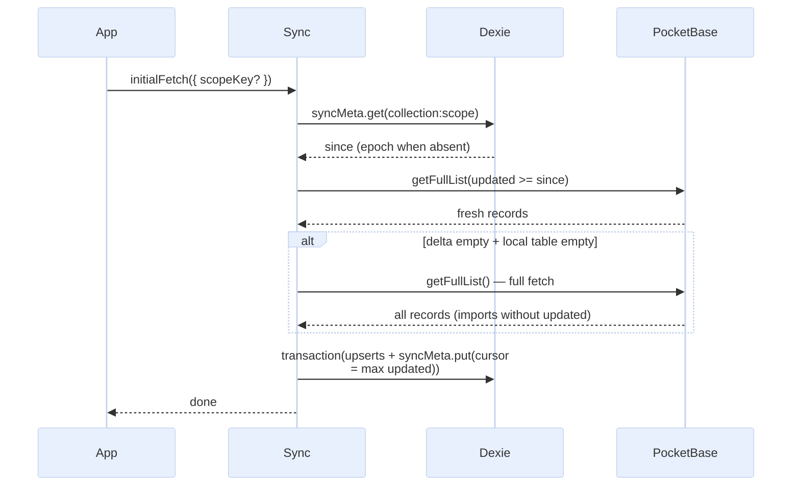
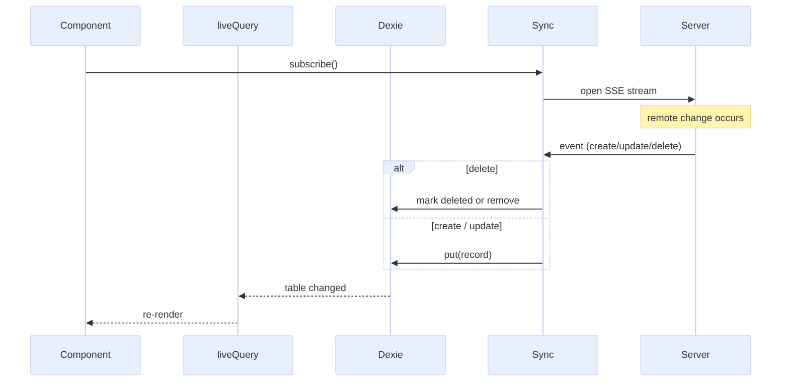
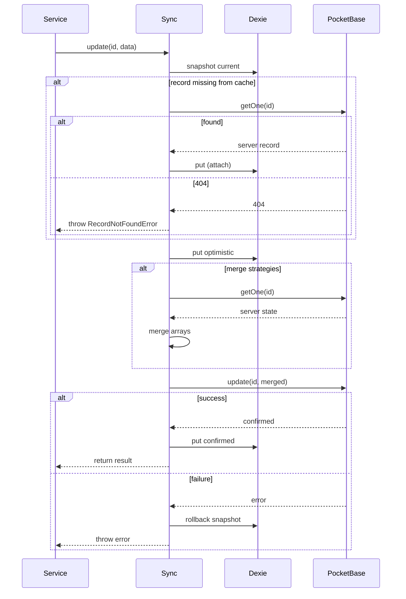
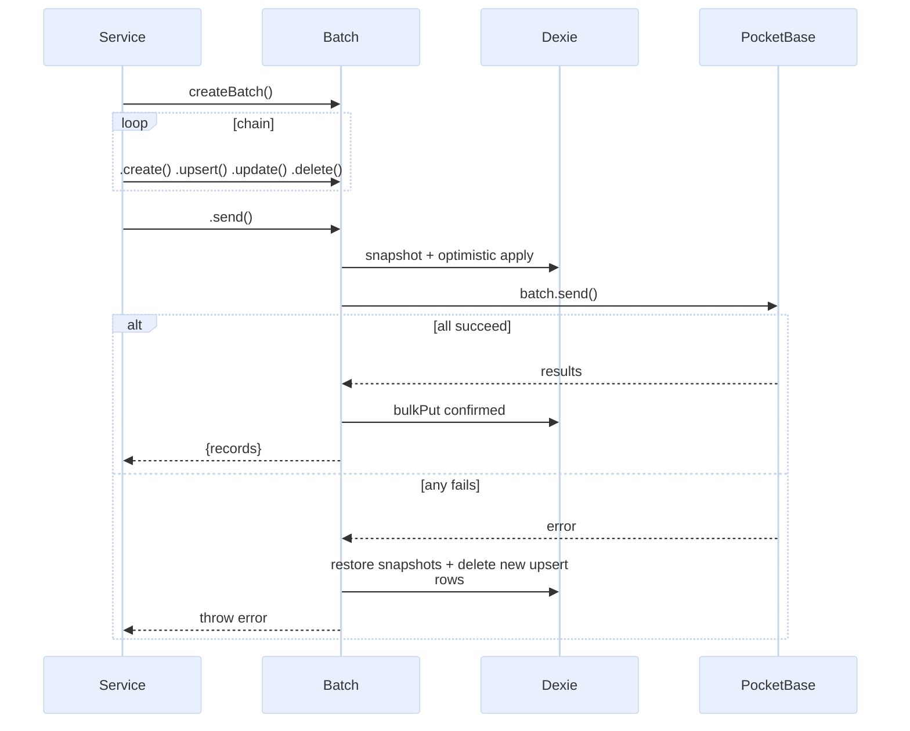

# pb-sync

Offline-first synchronization layer bridging **PocketBase** (remote) and **Dexie / IndexedDB** (local).

## Architecture

```
┌─────────────┐     createSyncCollection()     ┌──────────┐
│ PocketBase  │ ◄────── CRUD / Batch ─────────► │  Dexie   │
│  (remote)   │ ◄────── realtime events ─────── │ (local)  │
└─────────────┘                                 └────┬─────┘
                                                     │
                                               useLiveQuery()
                                               bridgeToMap()
                                                     │
                                               ┌──────▼──────┐
                                               │  Svelte 5   │
                                               │ components  │
                                               └─────────────┘
```

---

## Cache identity invariant

The local cache (private tables + `syncMeta` cursors) belongs to **exactly one
identity**. The owner is recorded in `localStorage` (`enka-cache-owner`, written
by `GlobalState.#purgePrivateCaches` only after a successful purge).

Every identity transition — boot, login, logout, register — runs
`GlobalState.#ensureCacheForIdentity` (serialized, idempotent, driven by the
`onAuthChange` watcher plus explicit boot/login calls): when the observed
identity differs from the marker, private stores are purged via their
`purgeLocal()` (cache only — subscriptions and live bridges stay alive and
self-reconcile; `recipes` is public and never purged).

Why it matters: a cache inherited from another session (tab closed without
logout, expired token) leaves a stale delta cursor — the next `syncInitial`
fetches `updated >= staleCursor` (mute) and the full-fetch fallback is blocked
because `localCount > 0`. Data would never load without a manual reload.
Cursors are per-collection keys in `syncMeta`; only `clearLocal()` removes
them — never treat a cursor as identity-independent.

---

## Create idempotency seam

`create()` passes a client-provided `id` through to PocketBase (`keepId`), and
PocketBase **preserves** it (format: exactly 15 chars of `[a-z0-9]`) and
**rejects a second create carrying the same id** with `400
validation_not_unique` on the `id` field (measured on PB 0.37.5). A client id
is therefore an idempotency key: after an ambiguous failure (request sent,
response lost), resubmitting with the SAME key can never duplicate — the
record already created is read back under the key (`view()`) and mirrored to
Dexie, while a key the server has never seen proves the failure was real and
the original error is rethrown.

Usage: generate the key once per submission intent (`newPbId()` from
`$lib/utils/pb-id`) and hold it across retries of that intent — reference
implementation: `EventsStore.createEventWithTeams(data, teamIds,
submissionKey)`.

Why it matters: nothing else protects against duplication on a flaky
connection — there is no offline replay queue (`create` is server-first:
throw on failure, nothing persisted) and no SDK retry; only the user's manual
resubmission after an error toast can duplicate, and this seam closes it.

---

## Upsert primitive

`upsert()` (unit sugar), `bulkUpsert(items)` and `createBatch().upsert(data)`
expose the **PocketBase native upsert** (`PUT /api/collections/{name}/records`,
registered through `pb.createBatch()`): the server executes the request as an
**update when the body carries an id that already exists**, as a **create
otherwise**. Use it when the caller cannot know whether the record is already
on the server — the primitive tranches both ways.

- The SDK has **no single-record upsert on `RecordService`** (0.26.x) —
  everything goes through a batch; the unit sugar is a one-operation batch.
- A client-provided id is preserved (same `keepId` seam as `create`), so an
  upsert replayed after an ambiguous failure can never duplicate.
- `created`/`updated` are stripped from the body (`keepId=true` strip) — the
  server owns the timestamps on both legs.
- Local mirror: rows with an id are written optimistically (patch on an
  existing row, plain put otherwise); the confirmed `bulkPut` after `send()`
  replaces them with the server state. Id-less upserts mirror only from the
  confirmation.
- Rollback on batch failure: snapshots of pre-existing rows are restored, and
  the rows an optimistic upsert **created** (no pre-batch snapshot) are
  deleted — a failed batch leaves no orphan line behind.
- Not a replacement for materializing a **virtual record** (semantic id like
  `cannelle_xxxxxxxxxxxxxxx`): PB only takes the update leg for an id that
  *exists* server-side; an unknown/invalid id lands on the create leg, which
  rejects a malformed id. `ProductsStore.#ensureSyncedProduct` stays the path
  for those.

---

## Flow Diagrams

### 1. Initial Fetch — Delta Sync

`initialFetch()` retrieves only records changed since the persisted cursor of this
collection — scoped by `scopeKey` when the fetch is filtered (ex. per-event), key
`collection:scope` in the `syncMeta` table. The cursor is written in the SAME
Dexie transaction as the upserts: a failed upsert rolls back both. The delta
filter is `updated >= since` (boundary records replay; the by-id upsert makes it
idempotent). With no cursor yet (first sync of a scope), `since` is the epoch —
a full fetch of the scope, which also heals caches left by the old table-derived
cursor (Dexie v10 bump).



### 2. Realtime Subscription — Server → UI

PocketBase pushes events via SSE. pb-sync mirrors them to Dexie, triggering reactive UI updates.



### 3. CRUD Write — Optimistic Update with Rollback

Writes are optimistic: Dexie updates immediately, then PocketBase. On failure, Dexie rolls back.

Offline-first contract: when the record is missing from the local cache,
`update` first tries to **attach** it — `getOne`, mirror to Dexie — then proceeds
with the optimistic write. If the server returns 404 too, `update` throws the
typed `RecordNotFoundError`: the caller decides whether to upsert (e.g.
materialize a virtual record client-side, then update the new server id — see
`ProductsStore.#updateWithUpsert`) or surface the error. A 404 on the push
itself (record deleted server-side, or update-rule rejection — PB answers 404
there) still takes the `RecordDeletedError` soft-delete path.



### 4. Batch Operations — Atomic Multi-Record

`createBatch()` chains operations into a single PocketBase batch request with full rollback.



---

## Modules

| File                       | Purpose                                                                  |
| -------------------------- | ------------------------------------------------------------------------ |
| `pb.ts`                    | PocketBase client singleton (`new PocketBase(PB_URL)`)                   |
| `pb-collection.ts`         | `createSyncCollection()` — main bridge API (CRUD, batch, upsert, delta)  |
| `pb-types.ts`              | Shared TypeScript types (`PbDoc`, `PbFetchOptions`, `PbSyncOptions`…)    |
| `pb-sync.ts`               | Barrel export — single entry point for stores                            |
| `pb-realtime.ts`           | SSE connection signals (`initRealtimeSignals` / `teardownRealtimeSignals`) |
| `aw-db.ts`                 | Dexie database schema (`EnkaDB`) + `syncMeta` cursor table               |
| `aw-bridge.ts`             | `bridgeToMap()` / `bridgeToMapFiltered()` — Dexie liveQuery → SvelteMap  |
| `aw-types.ts`              | `PbDoc` canonical shape + merge strategies                               |
| `use-live-query.svelte.ts` | Svelte 5 reactive wrapper around Dexie `liveQuery`                       |

---

## API Reference

### `createSyncCollection<T>(pb, table, collectionName, options?)`

Creates a sync collection that binds a PocketBase collection to a Dexie table with realtime subscriptions and conflict-resolution strategies.

**Parameters:**

| Param            | Type                  | Description                        |
| ---------------- | --------------------- | ---------------------------------- |
| `pb`             | `PocketBase`          | PocketBase client instance         |
| `table`          | `Dexie.Table<T>`      | Dexie table to sync with           |
| `collectionName` | `PbCollectionName`    | PocketBase collection name         |
| `options`        | `PbSyncOptions<T>`    | Optional configuration (see below) |

**Options:**

```ts
interface PbSyncOptions<T> {
	mergeStrategies?: {
		// Per-field merge function: (localValue, remoteValue) => mergedValue
		[K in keyof T]?: (local: T[K], remote: T[K]) => T[K];
	};
	softDelete?: boolean; // default: false — mark deleted instead of removing
	onSubscriptionChange?: (active: boolean) => void;
}
```

**Returns** an object with the following methods:

#### Lifecycle

| Method           | Signature                                                          | Description                                                                                                                                  |
| ---------------- | ------------------------------------------------------------------ | -------------------------------------------------------------------------------------------------------------------------------------------- |
| `initialFetch`   | `(fetchOptions?: PbFetchOptions) => Promise<void>`                 | Incremental sync: fetches records updated since the persisted cursor (scoped by `scopeKey`). Cursor + upserts written in one transaction.     |
| `subscribe`      | `(subOptions?: PbSubscribeOptions) => PbSubscriptionRef`           | Opens a PocketBase realtime subscription. Events are applied to Dexie. Returns a `PbSubscriptionRef` for later unsubscription.                |
| `unsubscribe`    | `(subRefOrId: PbSubscriptionRef \| string) => Promise<void>`       | Closes a specific realtime subscription.                                                                                                     |
| `unsubscribeAll` | `() => Promise<void>`                                              | Closes all active realtime subscriptions for this collection.                                                                                |

#### CRUD

| Method   | Signature                                                              | Description                                                                                                          |
| -------- | ---------------------------------------------------------------------- | -------------------------------------------------------------------------------------------------------------------- |
| `create` | `(data: Omit<T, 'id' \| 'created' \| 'updated'> & { id?: string }) => Promise<T>` | Creates a record on PocketBase (client id preserved), then mirrors to Dexie.                            |
| `update` | `(id: string, data: Partial<T>) => Promise<T>`                         | Optimistic write to Dexie, then PocketBase. On failure, rolls back Dexie. Applies merge strategies for array fields. Missing from cache: attaches the server record first; `RecordNotFoundError` when absent from both. |
| `remove` | `(id: string) => Promise<void>`                                        | Deletes from Dexie and PocketBase — hard by default, marked `{deleted: true}` when the `softDelete` option is set. Rolls back on failure. |

#### Batch & Upsert

| Method        | Signature                                                                                 | Description                                        |
| ------------- | ----------------------------------------------------------------------------------------- | -------------------------------------------------- |
| `createBatch` | `() => CollectionBatch<T>`                                                                | Returns a chainable batch builder.                 |
| `upsert`      | `(data: Omit<T, 'id' \| 'created' \| 'updated'> & { id?: string }) => Promise<T>`         | Sugar: one-operation batch upsert (update if the id exists server-side, create otherwise). |
| `bulkCreate`  | `(items: Omit<T, 'id' \| 'created' \| 'updated'>[]) => Promise<T[]>`                      | Shorthand: create multiple records.                |
| `bulkUpdate`  | `(items: { id, data: Partial<T> }[]) => Promise<T[]>`                                     | Shorthand: update multiple records.                |
| `bulkUpsert`  | `(items: (Omit<T, 'id' \| 'created' \| 'updated'> & { id?: string })[]) => Promise<T[]>`  | Shorthand: upsert multiple records.                |
| `bulkDelete`  | `(ids: string[]) => Promise<void>`                                                        | Shorthand: delete multiple records.                |

`CollectionBatch<T>` — chainable, terminates with `send(): Promise<{ records: T[] }>`:

```ts
interface CollectionBatch<T> {
	create(data: Omit<T, 'id' | 'created' | 'updated'> & { id?: string }): CollectionBatch<T>;
	upsert(data: Omit<T, 'id' | 'created' | 'updated'> & { id?: string }): CollectionBatch<T>;
	update(id: string, data: Partial<T>): CollectionBatch<T>;
	delete(id: string): CollectionBatch<T>;
	send(): Promise<BatchResult<T>>;
}
```

#### Read (direct PocketBase)

| Method | Signature                                             | Description                                     |
| ------ | ----------------------------------------------------- | ----------------------------------------------- |
| `list` | `(params?: PbListOptions) => Promise<PaginatedList<T>>` | Paginated query directly to PocketBase.         |
| `view` | `(id: string, params?: PbFetchOptions) => Promise<T>` | Fetch a single record directly from PocketBase. |

#### Utility

| Method           | Signature                   | Description                                                                        |
| ---------------- | --------------------------- | ---------------------------------------------------------------------------------- |
| `getTable`       | `() => Table<T>`            | Returns the underlying Dexie table for direct queries.                              |
| `collectionName` | getter                      | Returns the PocketBase collection name.                                             |
| `clearLocal`     | `() => Promise<void>`       | Clears the Dexie table + this collection's `syncMeta` cursors (logout / identity).  |

---

### `mergeByKey<T>(key: string)`

Factory that creates a merge strategy for array fields. Merges local and remote arrays by a unique key, preferring local values on conflict.

```ts
// Example: merge the materiels lines of a loan by their key
mergeStrategies: {
	materiels: mergeByKey<MaterielLine>('materielId');
}
```

---

### `useLiveQuery<T>(querier, deps?)`

Svelte 5 reactive wrapper. Must be called from a component `<script>` block (requires `$effect` context).

```ts
const query = useLiveQuery(
	() => db.products.get(productId),
	() => [productId] // optional reactive deps
);

// query.current  — latest value
// query.isLoading — boolean
// query.error    — any
```

---

### Query Options

All fetches accept `PbFetchOptions`:

```ts
interface PbFetchOptions {
	filter?: string | [template: string, vars: Record<string, unknown>];
	scopeKey?: string; // scopes the syncMeta delta cursor (collection:scope) —
	// required whenever `filter` scopes the fetch (ex. per-event)
	expand?: string; // e.g. 'author,team'
	fields?: string; // e.g. 'id,title,updated'
	query?: Record<string, string>; // raw query params
}

interface PbSubscribeOptions extends PbFetchOptions {
	record?: string; // specific record ID, or omit for '*'
}

interface PbListOptions extends PbFetchOptions {
	sort?: string;
	page?: number;
	perPage?: number;
}
```

> **SSE naming (measured on PB 0.37.5, probe T05)** : the SSE event is named
> after the SUBSCRIBED pattern (`teamdocs/*` or `teamdocs/<id>`), not the
> concrete record topic — a hand-rolled client must match on its own
> subscription string and `record.id` in the payload. Delivery follows the
> viewRule per record (cross-user delivery probed by
> `scripts_dev/probe-t05-teamdocs-sse.ts`).
>
> **Delivery rule timing (measured on PB 0.37.5, probe T06)** : for an
> `update` action the viewRule is evaluated on the POST-update record state —
> a write that GRANTS a user visibility (e.g. adding them to `events.guestUsers`)
> delivers that very update to them in real time. Subscribers therefore see a
> record appear without any refetch the moment a rule clause starts covering
> them (probed by `scripts_dev/probe-t06-rsvp-visibility.ts`, `--fixed` mode).

---

## Usage in the Project

### 1. Store Setup — the 3-phase pattern

Stores own one sync collection each and drive it through three phases:

```ts
await store.loadCache(); // Dexie → SvelteMap via bridgeToMap liveQuery
await store.syncInitial(); // PocketBase → Dexie via initialFetch()
await store.setupRealtime(); // SSE → Dexie via subscribe()
```

Logout delegates to the cache-identity path (`purgeLocal()` / `clearLocal()`) —
see « Cache identity invariant » above.

### 2. CRUD via the collection

Components never call PocketBase directly. Stores go through the sync collection:

```ts
// Create (client id optional — keepId seam)
const product = await productsCollection.create({ eventId, productName, ... });

// Optimistic update with rollback
await productsCollection.update(id, { who: [...] });

// Delete
await productsCollection.remove(id);
```

### 3. Batch and upsert

```ts
// Chain several operations into one atomic request
const batch = productsCollection.createBatch();
for (const p of items) batch.update(p.id, { status: 'archived' });
const { records } = await batch.send();

// Create-or-update decided server-side (id exists → update, else create)
const record = await productsCollection.upsert(data);
const many = await productsCollection.bulkUpsert(items);
```

### 4. Component Reactive Reads

Components read from Dexie — via `bridgeToMap()` (SvelteMap-backed) or
`useLiveQuery` — never directly from PocketBase.

---

## Database Schema (`aw-db.ts`)

`EnkaDB` — one table per synced PocketBase collection (`id` primary key, `updated`
index for the delta cursor) plus local-only tables:

```ts
// Synced collections (pb-sync)
events, products, purchases, recipes, materiels, materielLoans,
eventMateriels, teamdocs, locks, eventTodos, shareLinks,
ingredients, categories

// Local-only
recipeData, catalog      // Hugo static data
productNeeds             // calculated needs (event.meals → recipes → ingredients)
nativeTeams, joinLinks   // caches
syncMeta                 // delta cursors — key `${collection}:${scopeKey}`
```

Svelte 5 `$state` proxies are dereferenced at the pb-sync write boundary
(`toPlain()` in `pb-collection.ts`) — IndexedDB `structuredClone` cannot clone
proxies.

---

## Error Handling

- **CRUD rollback**: `update()` and `remove()` snapshot the local record before sending to PocketBase. On failure, the snapshot is restored.
- **Batch rollback**: `createBatch().send()` snapshots all affected records before the optimistic phase. On failure, snapshots are restored and the rows a *new* upsert created locally are deleted — no orphan line survives.
- **Typed errors**: `RecordDeletedError` (404 on push — hard-deleted server-side) and `RecordNotFoundError` (record absent from cache AND server — the caller may upsert or surface it), both exported from the barrel.
- **Unsubscription failures**: swallowed in `unsubscribeAll()` (non-blocking) — teardown never prevents identity transitions.

